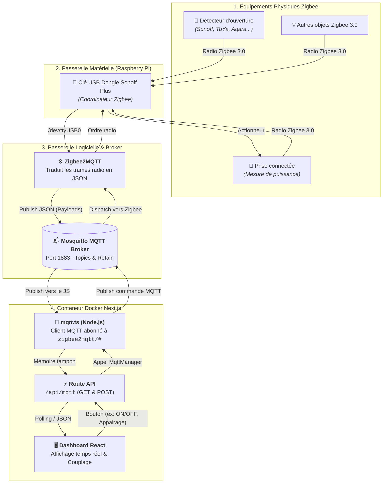
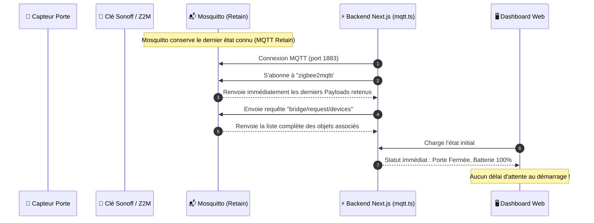

# 📡 Architecture IoT : Zigbee, Mosquitto & Next.js

Ce document détaille le flux complet de communication entre les équipements Zigbee physiques, le broker MQTT Mosquitto et l'application web Next.js.

---

## 🗺️ Schéma d'Architecture Global



---

## 📦 Exemples réels de Payloads JSON échangés

### 1. Détecteur d'ouverture de porte (Capteur)
* **Topic :** `zigbee2mqtt/0x8c73dafffeceac07`
* **Direction :** Capteur ➔ Mosquitto ➔ Dashboard JS
* **Payload JSON :**
```json
{
  "contact": true,          // true = Porte FERMÉE | false = Porte OUVERTE
  "battery": 100,           // % restant de la pile
  "battery_low": false,     // Alerte pile faible
  "tamper": false,          // Détection d'arrachement / sabotage
  "linkquality": 207        // Qualité du signal radio (0 à 255)
}
```

---

### 2. Prise connectée (Télémétrie)
* **Topic :** `zigbee2mqtt/0xa4c13810f2d8ffff`
* **Direction :** Prise ➔ Mosquitto ➔ Dashboard JS
* **Payload JSON :**
```json
{
  "state": "ON",            // ON ou OFF
  "power": 30.43,           // Puissance instantanée consommée en Watts
  "current": 0.25,          // Courant en Ampères
  "voltage": 243.64,        // Tension du secteur en Volts
  "energy": 0.0,            // Consommation cumulée en kWh
  "linkquality": 180        // Qualité de réception radio
}
```

---

### 3. Actionnement d'une prise (Commande descendante)
* **Topic :** `zigbee2mqtt/0xa4c13810f2d8ffff/set`
* **Direction :** Dashboard JS ➔ Mosquitto ➔ Prise
* **Payload JSON :**
```json
{
  "state": "TOGGLE"         // ou "ON" / "OFF"
}
```

---

### 4. Gestion de l'Appairage (Couplage par API)
* **Topic :** `zigbee2mqtt/bridge/request/permit_join`
* **Direction :** Dashboard JS ➔ Mosquitto ➔ Clé Sonoff
* **Payload JSON :**
```json
{
  "value": true,            // true = autoriser le couplage, false = verrouiller
  "time": 254               // Durée d'ouverture en secondes
}
```

---

## ⚡ Pourquoi c'est opérationnel dès le démarrage ?


